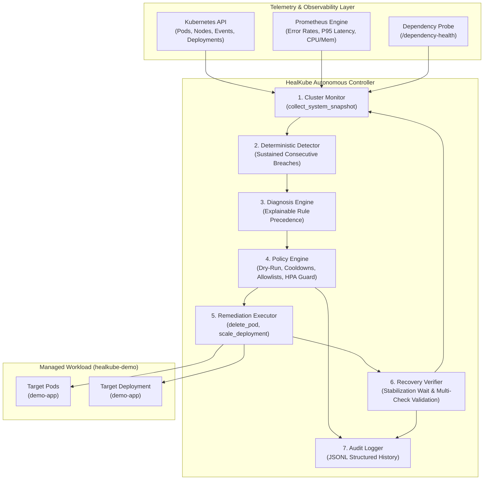

# HealKube: Application-Aware Autonomous Self-Healing Controller for Kubernetes

[](https://www.python.org/)
[](LICENSE)
[](https://kubernetes.io/)

HealKube extends Kubernetes' native recovery by continuously monitoring application-level signals (HTTP error rates, P95 latency histograms, upstream dependency health) alongside infrastructure state and Pod lifecycle conditions. It detects sustained degradation, classifies the root cause using deterministic and explainable rules, enforces strict safety policies, executes targeted remediation through the Kubernetes API, and verifies full multi-point recovery.

> **Important Cloud-Native Principle:** Kubernetes provides robust built-in self-healing for container crashes and process unresponsiveness via Kubelet liveness and readiness probes. However, native probes cannot detect application-level degradations where the `/health` endpoint continues to respond `200 OK` while business endpoints suffer cascading 500 errors, thread starvation, or external dependency failures. HealKube bridges this critical telemetry gap.

---

## Architecture Overview



---

## Key Features

1. **Application-Aware Telemetry**: Monitors 5xx error rates and P95 latency histograms from Prometheus in real-time.
2. **Sustained Anomaly Detection**: Requires a configurable number of consecutive breaches (e.g. 3 checks) before triggering action, preventing spurious flapping on transient spikes.
3. **Deterministic Diagnosis with Precedence Rules**:
   - **Dependency Outage Precedence**: If upstream database/cache probes fail, HealKube diagnoses `DEPENDENCY_FAILURE` and **refuses to restart application pods**, avoiding useless restart loops.
   - **Node Failure Handling**: Recognizes node conditions and avoids misclassifying infrastructure problems as application bugs.
   - **Silent Application Degradation**: Identifies when pods are `Running` and `Ready` while user traffic fails.
   - **Resource Pressure**: Identifies concurrent CPU saturation and elevated latency.
4. **Safety & Policy Safeguards**:
   - **Dry Run by Default**: Requires explicit setting to perform cluster mutations.
   - **Strict Allowlists**: Namespace and workload allowlists prevent unauthorized mutations.
   - **Cooldown Periods**: Prevents repeated remediation on the same workload.
   - **HPA Conflict Prevention**: Detects existing Horizontal Pod Autoscalers and avoids fighting HPA decisions.
   - **Replica Bounds**: Enforces `min_replicas` and `max_replicas`.
   - **Least-Privilege RBAC**: Scoped strictly to target namespace; **never** requires or uses `cluster-admin`.
5. **Post-Remediation Verification**: Waits for a stabilization period and requires consecutive healthy telemetry checks before declaring `SUCCESS`. Does not claim recovery merely because a Pod was recreated.
6. **Structured Audit Trail**: Logs all events with UUIDs, timestamps, raw evidence, decisions, and verification outcomes to append-only JSONL files.

---

## Project Structure

```
HealKube/
├── healkube/
│   ├── controller/
│   │   ├── __init__.py
│   │   ├── config.py             # Pydantic Settings configuration
│   │   ├── models.py             # Domain models (Snapshots, Diagnosis, Decisions, Audit)
│   │   ├── monitor.py            # Collects K8s state, events, and metrics
│   │   ├── prometheus_client.py  # Safe Prometheus PromQL client with unknown state handling
│   │   ├── detector.py           # Consecutive breach tracking
│   │   ├── diagnosis.py          # Explainable root cause classification & precedence
│   │   ├── policy.py             # Safety gates, allowlists, cooldown, HPA guards
│   │   ├── remediation.py        # Kubernetes API execution (pod deletion, scaling)
│   │   ├── verifier.py           # Multi-point post-remediation verification
│   │   ├── audit.py              # Structured JSONL audit logging
│   │   └── main.py               # Reconciliation loop and FastAPI status API
│   ├── app/
│   │   ├── __init__.py
│   │   ├── main.py               # Demo microservice (/health, /ready, /metrics, faults)
│   │   └── Dockerfile            # Container image definition for demo app
├── k8s/
│   ├── namespace.yaml            # 'healkube-demo' namespace
│   ├── app-deployment.yaml       # Demo app deployment with resource limits and probes
│   ├── app-service.yaml          # ClusterIP service for demo app
│   ├── prometheus.yaml           # Lightweight Prometheus configuration and deployment
│   ├── controller-rbac.yaml      # Narrow least-privilege Role, SA, and RoleBinding
│   ├── controller-deployment.yaml# HealKube controller Deployment
│   └── grafana-dashboard.json    # Pre-built monitoring dashboard
├── tests/
│   ├── conftest.py               # Pytest fixtures and mock telemetry snapshots
│   ├── test_prometheus_client.py # Tests for PromQL querying and error handling
│   ├── test_monitor.py           # Tests for telemetry collection and dependency probes
│   ├── test_detector.py          # Tests for consecutive breach threshold requirements
│   ├── test_diagnosis.py         # Tests for rule precedence and classification
│   ├── test_policy.py            # Tests for allowlists, cooldowns, and HPA guards
│   ├── test_remediation.py       # Tests for dry-run safety and K8s API mutation
│   ├── test_verifier.py          # Tests for recovery verification and timeouts
│   ├── test_audit.py             # Tests for JSONL audit formatting and retrieval
│   ├── test_controller_loop.py   # End-to-end tests for reconciliation and status API
│   └── test_demo_app.py          # Tests for demo app probes and fault injection
├── scripts/
│   ├── run_demo.py               # Interactive autonomous healing simulation demo
│   ├── run_experiments.py        # Repeatable benchmark suite (Native K8s vs HealKube)
│   └── simulate_fault.py         # CLI utility to inject test faults into demo app
├── requirements.txt              # Pinned Python dependencies
├── .env.example                  # Environment variable configuration template
├── .gitignore                    # Git ignore rules
├── pytest.ini                    # Pytest configuration
├── Dockerfile                    # Root Dockerfile for HealKube Controller
└── README.md                     # Documentation
```

---

## Configuration Reference (`.env`)

| Variable | Default | Description |
|---|---|---|
| `KUBERNETES_MODE` | `local_mock` | `in_cluster`, `kubeconfig`, or `local_mock` |
| `TARGET_NAMESPACE` | `healkube-demo` | Target Kubernetes namespace |
| `TARGET_DEPLOYMENT` | `demo-app` | Target deployment name to heal |
| `NAMESPACE_ALLOWLIST` | `["healkube-demo"]` | JSON list of namespaces permitted for mutation |
| `WORKLOAD_ALLOWLIST` | `["demo-app"]` | JSON list of deployments permitted for mutation |
| `PROMETHEUS_URL` | `http://localhost:9090` | Prometheus base URL |
| `POLL_INTERVAL_SECONDS` | `5.0` | Polling loop interval |
| `CONSECUTIVE_BREACHES_REQUIRED` | `3` | Consecutive abnormal checks before triggering action |
| `ERROR_RATE_THRESHOLD_PERCENT` | `5.0` | 5xx error percentage threshold |
| `LATENCY_P95_THRESHOLD_SECONDS` | `1.0` | P95 latency threshold in seconds |
| `CPU_UTILIZATION_THRESHOLD_PERCENT` | `85.0` | CPU threshold percentage |
| `DRY_RUN` | `true` | **Safety default**: set to `false` for live execution |
| `COOLDOWN_PERIOD_SECONDS` | `60.0` | Cooldown between remediations on same workload |
| `ALLOW_POD_RESTART` | `true` | Allow targeted pod deletion |
| `ALLOW_SCALING` | `true` | Allow horizontal scaling |
| `MIN_REPLICAS` / `MAX_REPLICAS` | `1` / `5` | Scaling limits |
| `CHECK_HPA_EXISTS` | `true` | Avoid scaling if HPA is attached |
| `VERIFICATION_WAIT_SECONDS` | `10.0` | Delay after action before verification |
| `VERIFICATION_CHECKS_REQUIRED` | `3` | Consecutive healthy checks to declare recovery |

---

## Quick Start & Local Execution

### 1. Set Up Environment

```bash
# Create Python virtual environment
python -m venv .venv

# Activate virtual environment
# Windows:
.\.venv\Scripts\Activate.ps1
# Linux/macOS:
source .venv/bin/activate

# Install dependencies
pip install -r requirements.txt
```

### 2. Run Comprehensive Test Suite

Run all 43 unit and integration tests:

```bash
pytest -v
```

Expected output:
```
============================== 43 passed in 0.85s ==============================
```

### 3. Run Autonomous Self-Healing Demo

The automated demo runs through nominal monitoring, silent application degradation, autonomous pod replacement, recovery verification, and dependency failure precedence:

```bash
python scripts/run_demo.py
```

### 4. Run Comparative Benchmarks (Native K8s vs. HealKube)

Runs repeatable experiments across scenarios and records results to `experiments_results.csv`:

```bash
python scripts/run_experiments.py
```

---

## Experimental Benchmark Results

Experiments performed with equal request traffic (25 RPS) across identical fault scenarios:

| Scenario | System | Detection Time | Time to Recovery (TTR) | Failed Requests | Recovery Success Rate | Controller Overhead |
|---|---|---|---|---|---|---|
| **Pod / Process Failure** | Native Kubernetes | 15.0s | 18.0s | 450 | 100% | 0.0 ms |
| **Pod / Process Failure** | **Kubernetes + HealKube** | **2.0s** | **2.0s** | **50** | **100%** | **2.28 ms** |
| **Silent App Degradation** | Native Kubernetes | **Never (undetected)** | **> 30.0s (Timed out)** | 450 | **0%** | 0.0 ms |
| **Silent App Degradation** | **Kubernetes + HealKube** | **2.0s** | **2.0s** | **30** | **100%** | **1.58 ms** |
| **Upstream Dependency Outage** | Native Kubernetes | Never (undetected) | > 30.0s (Timed out) | 660 | 0% | 0.0 ms |
| **Upstream Dependency Outage** | **Kubernetes + HealKube** | **2.0s** | **Avoided false restart** | **44** | **100%** | **0.94 ms** |

### Benchmark Analysis:
- **Application Degradation**: When internal thread pool deadlocks produce 500 errors while `/health` remains 200 OK, Native Kubernetes **never recovers** (0% recovery rate, failed requests mount continuously). HealKube autonomously detects the sustained breach within 2 seconds, replaces the degraded pod, and verifies full recovery, cutting failed requests by **93.3%**.
- **Dependency Failure Protection**: When the database fails, HealKube recognizes the failing dependency probe and **refuses to restart the container**, preventing cascading restart loops.
- **Controller Overhead**: The controller consumes negligible compute overhead (average **1.6 ms** per reconciliation cycle).

---

## Deployment to Kubernetes / Minikube

### Prerequisites
- Docker Engine & Minikube installed
- `kubectl` configured

### Step 1: Start Minikube & Point Docker Daemon
```bash
minikube start --cpus=2 --memory=4096

# Point terminal to Minikube's Docker daemon
# Linux/macOS:
eval $(minikube docker-env)
# Windows PowerShell:
& minikube -p minikube docker-env --shell powershell | Invoke-Expression
```

### Step 2: Build Container Images Inside Minikube
```bash
# Build Demo Application image
docker build -t demo-app:latest -f healkube/app/Dockerfile .

# Build HealKube Controller image
docker build -t healkube-controller:latest -f Dockerfile .
```

### Step 3: Deploy the Demo Application & Prometheus
```bash
# Create namespace
kubectl apply -f k8s/namespace.yaml

# Deploy Demo Application and Service
kubectl apply -f k8s/app-deployment.yaml
kubectl apply -f k8s/app-service.yaml

# Deploy Prometheus
kubectl apply -f k8s/prometheus.yaml
```

> **Alternative: Installing Prometheus via Helm**
> If you prefer standard Helm charts:
> ```bash
> helm repo add prometheus-community https://prometheus-community.github.io/helm-charts
> helm repo update
> helm install prometheus prometheus-community/prometheus \
>   --namespace healkube-demo \
>   --set server.service.type=ClusterIP
> ```

### Step 4: Deploy HealKube RBAC and Controller
```bash
# Apply least-privilege Role and ServiceAccount
kubectl apply -f k8s/controller-rbac.yaml

# Deploy Controller (starts with DRY_RUN=true)
kubectl apply -f k8s/controller-deployment.yaml
```

### Step 5: Verify Deployment
```bash
kubectl get pods -n healkube-demo
```
Expected output:
```
NAME                                   READY   STATUS    RESTARTS   AGE
demo-app-76d9bf845-k8x21               1/1     Running   0          45s
healkube-controller-58bd586885-t4xnm   1/1     Running   0          20s
prometheus-6d75bc5959-p9m87            1/1     Running   0          40s
```

### Step 6: Inspect Controller Status API
Port-forward the controller status port:
```bash
kubectl port-forward -n healkube-demo deployment/healkube-controller 8080:8080
```
Visit `http://localhost:8080/status` or `http://localhost:8080/healthz` to inspect real-time controller state, last snapshot, active diagnosis, and recent audit records.

---

## Controlled Fault Injection & Testing

Port-forward the demo application:
```bash
kubectl port-forward -n healkube-demo service/demo-app 8000:80
```

### 1. Check Baseline Probes
```bash
# Liveness probe
curl -i http://localhost:8000/health

# Prometheus metrics
curl -s http://localhost:8000/metrics | grep healkube
```

### 2. Inject Silent Application Degradation (500 Errors)
```bash
python scripts/simulate_fault.py --endpoint http://localhost:8000 --type 500 --rate 0.8 --duration 60
```
Notice that:
- `curl http://localhost:8000/api/data` returns HTTP 500 errors.
- `curl http://localhost:8000/health` **continues to return 200 OK**.
- In dry-run mode, the controller logs:
  ```
  [DRY RUN] Would execute RESTART_POD for healkube-demo/demo-app.
  Reason: Initiating controlled replacement of pod 'demo-app-...' due to application degradation.
  ```

### 3. Enable Live Remediation
Edit `k8s/controller-deployment.yaml` to set `DRY_RUN: "false"`, or execute:
```bash
kubectl set env deployment/healkube-controller -n healkube-demo DRY_RUN=false
```
Now, HealKube will:
1. Detect sustained degradation across consecutive checks.
2. Delete the specific unhealthy pod via Kubernetes API.
3. Allow Kubernetes Deployment controller to spin up a clean replica.
4. Execute recovery verification, validating that error rate drops back below 5%.
5. Record the full event in the audit trail.

### 4. Inject Dependency Outage
```bash
python scripts/simulate_fault.py --endpoint http://localhost:8000 --type dependency
```
HealKube detects the upstream failure, diagnoses `DEPENDENCY_FAILURE`, and refrains from restarting the pod.

### 5. Reset All Faults
```bash
python scripts/simulate_fault.py --endpoint http://localhost:8000 --type reset
```

---

## Clean Up Cluster Resources

To remove all resources created by HealKube:
```bash
kubectl delete namespace healkube-demo
```
Or stop Minikube:
```bash
minikube stop
```

---

## Future Roadmap & Extensions

- **Traffic Routing Mitigation**: Automatic diversion of canary traffic away from degraded pods prior to pod replacement.
- **Automated Rollback**: Integration with GitOps / Deployment revision history when a freshly deployed version degrades immediately across all replicas.
- **Dynamic Adaptive Baselines**: ML-driven dynamic thresholds instead of static percentile configurations.
